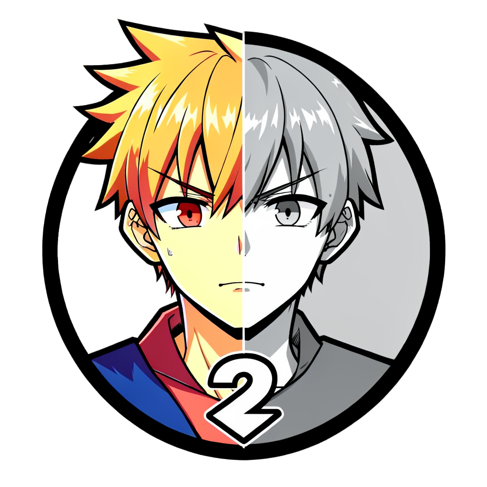
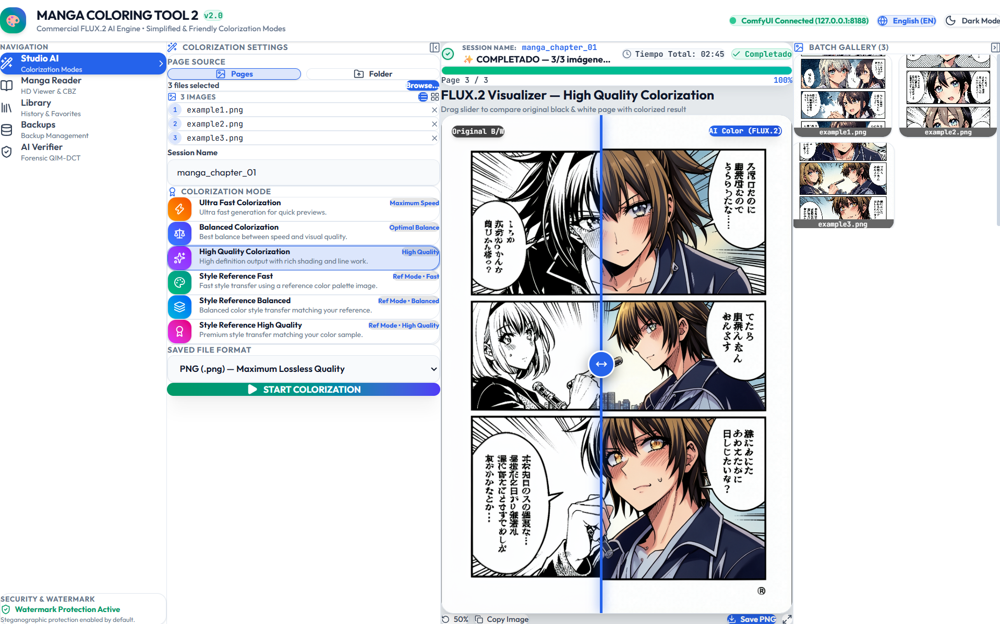
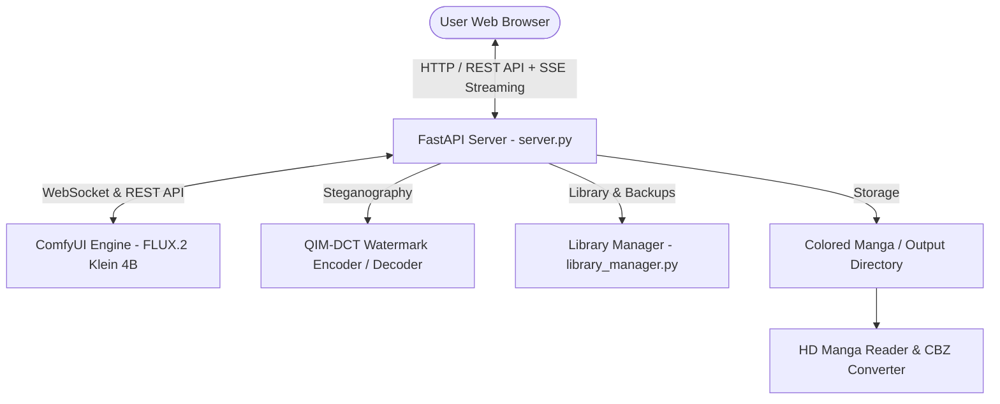
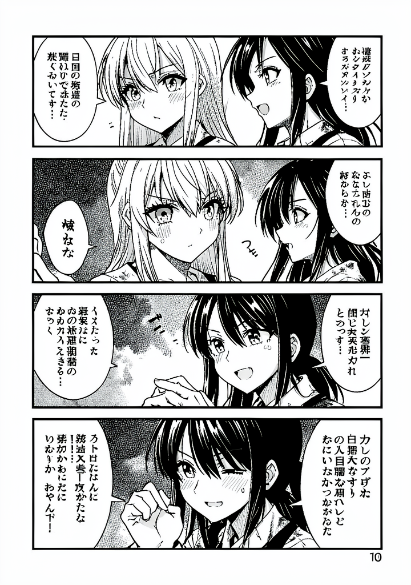
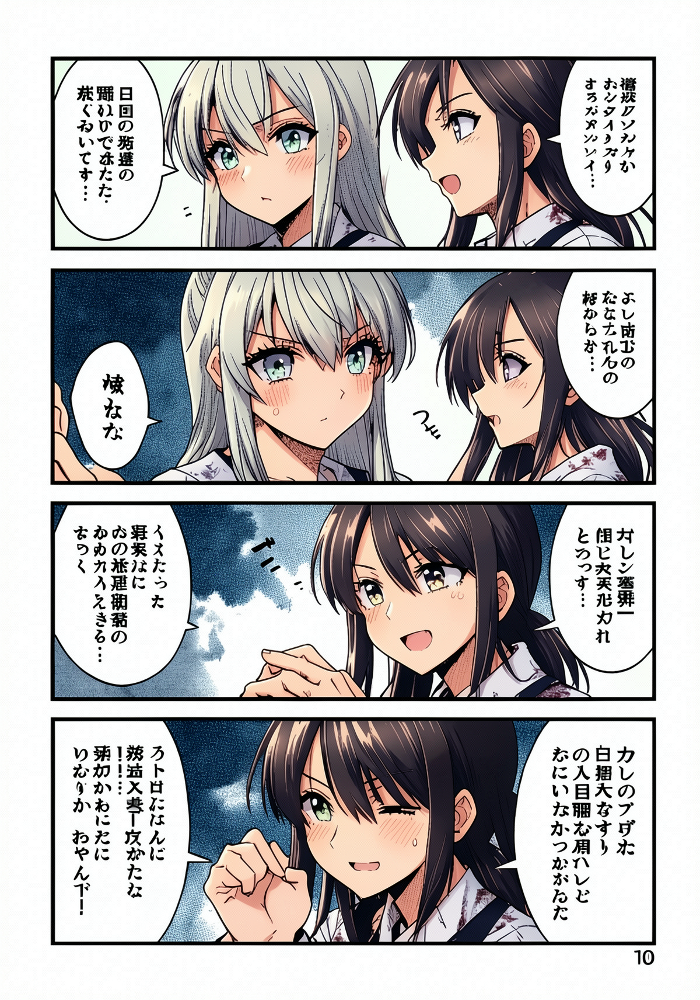
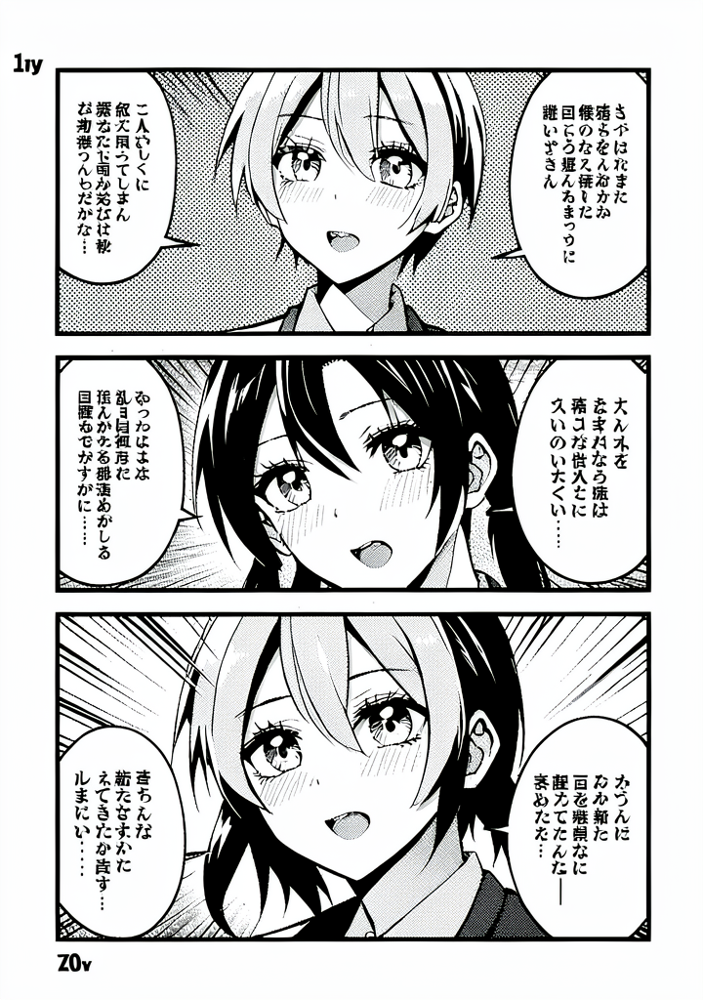
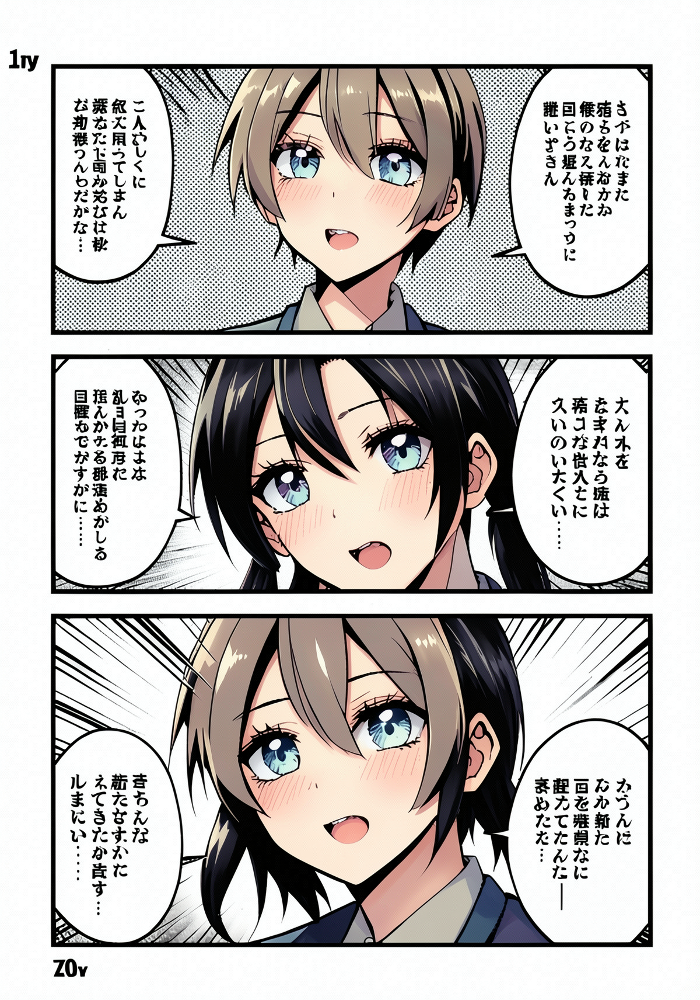
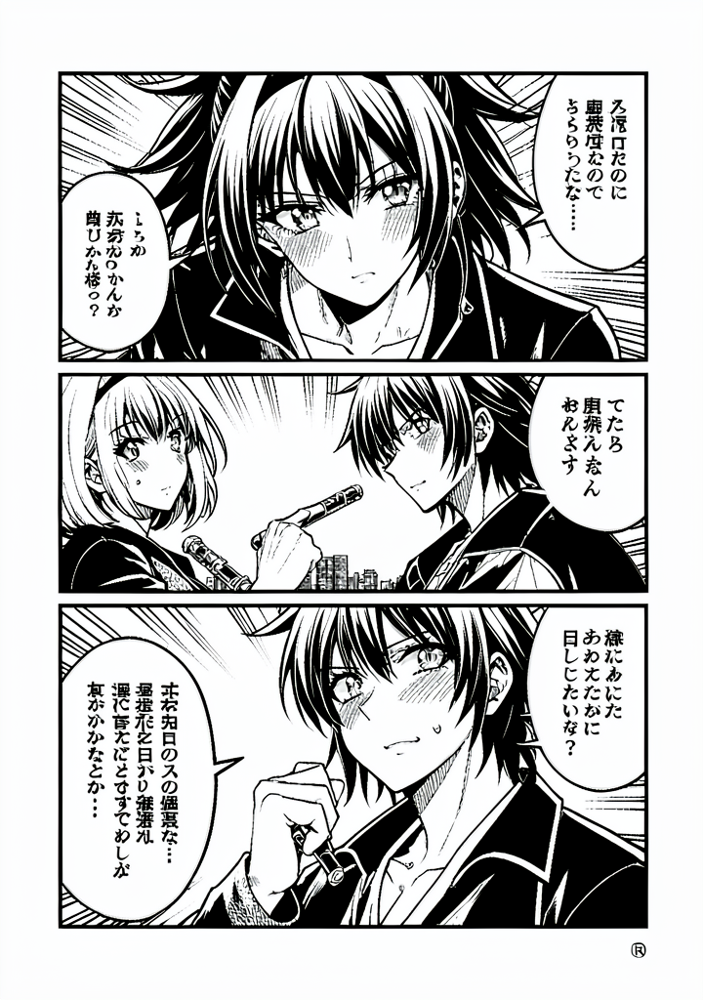
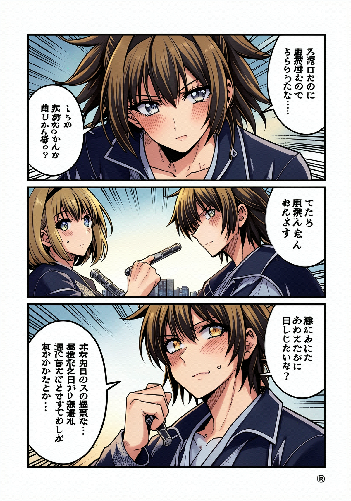

<div align="center">
  
</div>

<div align="center">


---

# DOWNLOAD MANGA COLORING TOOL 2
 # [WINDOWS (NVIDIA GPU)](https://codeberg.org/Gladioul/Manga_Coloring_Tool_2/releases/download/1.1/Manga_Coloring_Tool_2.zip)

 # [WINDOWS (AMD GPU) *Experimental,not tested*](https://codeberg.org/Gladioul/Manga_Coloring_Tool_2/releases/download/1.1/Manga_Coloring_Tool_2_AMD_GPU.zip)

 # [LINUX (NVIDIA GPU)](https://codeberg.org/Gladioul/Manga_Coloring_Tool_2/releases/download/1.1/Manga_Coloring_Tool_2_v2.0_Linux.zip)

 # [LINUX (AMD GPU) *Experimental,not tested*](https://codeberg.org/Gladioul/Manga_Coloring_Tool_2/releases/download/1.1/Manga_Coloring_Tool_2_v2.0_Linux_AMD_GPU.zip)

 

 ### ▶️ WATCH DEMO & TUTORIAL ON YOUTUBE
[](http://www.youtube.com/watch?v=LCzhJmvjs4A)


</div>

# 🎨 Manga Coloring Tool 2 — AI Manga Colorization Suite

     

**Manga Coloring Tool 2** is the next-generation, high-performance AI colorization suite designed specifically for manga artists, scanlation teams, and comic enthusiasts. Powered by the state-of-the-art **FLUX.2 Klein 4B (FP8)** architecture running locally via ComfyUI, this major 2.0 release replaces legacy interfaces with a commercial-grade **React + FastAPI** single-page application (SPA).

Transform black-and-white manga pages (lineart) into professionally shaded, vibrant colored artwork in seconds—optimized for 8GB VRAM consumer GPUs with zero cloud dependencies.

---

## ⚡ Quick Start & One-Click Execution

This software is designed to be **100% portable** and zero-configuration.

> **Important:** Download the **`Manga-Coloring-Tool-v2.0.0.zip`** from the [**Releases**](https://codeberg.org/Gladioul/Manga_Coloring_Tool_2/releases) section to get all pre-packaged models and dependencies.

### 📋 System Requirements

* **GPU:** NVIDIA Graphics Card (RTX 3000 series or higher recommended) with a minimum of **8GB VRAM**.
* **Drivers:** Latest NVIDIA Game Ready / Studio Drivers. *(No manual CUDA Toolkit installation required)*.
* **RAM:** 16 GB System Memory.
* **Storage:** 15 GB free disk space (for local FLUX.2 Klein model weights and execution environment).
* **OS:** Windows 10 / 11 (64-bit) or Linux (The source code is in other branch)

### 🚀 One-Click Launch

1. Unzip `Manga-Coloring-Tool-v2.0.0.zip` to your desired directory.
2. Double-click the **`run.bat`** file.
3. The automated startup script will verify Python dependencies, launch the local ComfyUI engine, start the FastAPI server, and automatically open the application in your default web browser at `http://127.0.0.1:7860`.

---

## 🌟 What's New in Version 2.0?

| Feature | Description |
| :--- | :--- |
| ⚛️ **React SPA Engine** | Built from the ground up with React 18, Vite, and Lucide React icons—replacing the legacy Gradio UI with ultra-fast responsiveness. |
| ⚡ **6 Simplified Modes** | No confusing technical sliders (CFG, Steps, Megapixels). Choose from curated Direct & Style Reference preset cards. |
| 🎨 **Style Reference Chaining** | Auto-chain reference colors across entire manga chapters for consistent character skin tones, hair, and clothing. |
| 📖 **HD Manga Reader** | Built-in reader featuring **Single Page**, **Double-Spread**, and **Webtoon Vertical** reading modes. |
| 📦 **1-Click CBZ Converter** | Export any colorized chapter directly into standard `.cbz` comic book archives for digital reader devices. |
| 🎨 **Palette Extractor** | Extract 6-color dominant hex palettes from reference images for artist reference and workflow planning. |
| 🔏 **Forensic Steganography** | Invisible QIM-DCT digital signature verification with drag-and-drop AI verification and compression stress testing. |
| 🛡️ **Full Backup & Recovery** | Export and restore full workspace states (history, favorites, custom presets, and saved library chapters) with Zip-Slip path protection. |
| ⏱️ **Real-Time Live Dashboard** | Live progress card featuring elapsed clocks, ETA counters, total batch execution duration, and `settings.txt` logging. |
| 🌐 **Bilingual i18n Switcher** | Instant 1-click language toggling between **English** and **Español**. |

---

## 🖥️ Interface & Usage Guide



### 1️⃣ Mode Selection & Data Input
- **Choose Colorization Mode**: Select one of 6 friendly preset cards on the left panel (e.g. *Ultra Fast*, *Balanced*, *High Quality*, or *Style Reference* modes).
- **Select Source Material**:
  - **Files Mode**: Drag and drop loose manga pages (`.png`, `.jpg`, `.webp`).
  - **Folder Mode**: Click **Pick Folder** to open a native OS folder dialog. The built-in scanner recursively discovers all manga pages in subfolders.

### 2️⃣ Reference Color Transfer (Optional)
- Upload a colored reference image (character sheet, anime screenshot, or previous chapter page).
- Enable **Auto Reference Chaining (`auto_ref`)**: Each newly colorized page automatically becomes the color reference for the next page, maintaining seamless color harmony across full chapters.

### 3️⃣ Real-Time Live Generation Dashboard
- Click **Start Colorization** (`Ctrl + Enter`).
- The live dashboard displays real-time progress:
  - Active page name & status.
  - Live progress bar and completion percentage.
  - Elapsed timer & ETA counter.
- When finished, the dashboard remains active, displaying the **Total Batch Execution Time** and automatically creating a detailed `settings.txt` report inside the chapter folder.

### 4️⃣ Before/After Interactive Visualizer & Gallery
- Drag the interactive split slider to compare the original B/W lineart side-by-side with the FLUX.2 Klein color output.
- Browse generated pages in the right-hand **Gallery Drawer**. Click any thumbnail to load it into the slider or pin it as a style reference.

---

## 🎨 Friendly Colorization Modes

No more guessing CFG scale values or sampling steps. Choose the preset tailored to your workflow:

| Mode | Type | Speed | Description |
| :--- | :--- | :---: | :--- |
| ⚡ **Ultra Fast Colorization** | Direct | ⚡⚡⚡ | Maximum speed. Ideal for fast previews and draft coloring. |
| ⚖️ **Balanced Colorization** | Direct | ⚡⚡ | Optimal balance between generation speed and rich shading. |
| 🌟 **High Quality Colorization** | Direct | ⚡ | High-definition shading with detailed line preservation and lighting. |
| 🎨 **Style Reference Fast** | Reference | ⚡⚡⚡ | Fast style transfer matching a reference image's color palette. |
| 🎨⚖️ **Style Reference Balanced** | Reference | ⚡⚡ | Balanced color transfer maintaining character color consistency. |
| 🎨🌟 **Style Reference High Quality** | Reference | ⚡ | Premium color transfer matching skin, hair, and clothing tones with fine shading. |

---

## 📐 Architecture & Workflow Pipeline



---

## 🖼️ Gallery: Before & After

Experience the quality and detail preservation of the **FLUX.2 Klein 4B** engine:

| Original Lineart | Colorized Output |
| :---: | :---: |
|  |  |
|  |  |
|  |  |

---

## 🕵️‍♂️ Invisible AI Watermark & Steganography Security

To ensure ethical AI usage, transparency, and copyright protection, every generated page includes an imperceptible steganographic digital signature (`AI_COLORED`).

* **Zero Visual Impact:** The watermark is embedded mathematically into the frequency components of the blue color channel using Quantization Index Modulation in the Discrete Cosine Transform domain (QIM-DCT).
* **Social Media Compression Resilience:** The signature survives JPEG compression, web re-scaling, and social media uploads (X/Twitter, Discord, Reddit).
* **Built-in Verifier:** Use the **AI Verifier** tab to drop any image, verify its signature, and test its robustness against compression stress.

---

## 💾 Folder Organization & `settings.txt` Reports

Output files are organized chronologically in clean, structured folders:

```
Colored Manga/
└── 2026/
    └── 7_Julio/
        └── 27/
            └── manga_chapter_01_Balanced_Colorization/
                ├── 0001.png
                ├── 0002.png
                ├── ...
                └── settings.txt
```

At the end of every generation session, a **`settings.txt`** report is automatically written to the folder:

```ini
Project: Manga Coloring Tool 2
Session Name: manga_chapter_01_Balanced_Colorization
Colorization Mode: Balanced Colorization
Output Format: PNG
Completed Images: 10/10
Total Time: 02:45
Average Time Per Image: 16.50s
Status: Completado
Completed At: 2026-07-27 17:35:10
```

---

## ❤️ Credits and Open Source Ecosystem

This project is made possible thanks to the amazing open-source AI community:

* **[Black Forest Labs](https://blackforestlabs.ai/):** Creators of the revolutionary **FLUX** architecture.
* **[Qwen](https://huggingface.co/Qwen):** For the powerful text encoder driving high-fidelity prompt understanding.
* **[ComfyUI](https://github.com/comfyanonymous/ComfyUI):** For the state-of-the-art node backend and memory management optimizing FLUX for 8GB GPUs.
* **[FastAPI](https://fastapi.tiangolo.com/):** For the ultra-fast Python web framework and SSE streaming backend.
* **[React](https://react.dev/):** For the interactive single-page web interface.
* **[Lucide React](https://lucide.dev/):** For the modern visual UI icon system.
* **[Hugging Face](https://huggingface.co/):** For model distribution and diffusers ecosystem.
* **[PyTorch & NVIDIA](https://pytorch.org/):** For hardware acceleration (CUDA/FP8).
* **[7-Zip](https://www.7-zip.org/):** For standalone extraction utilities in our 1-click launcher.

---

## ⚖️ Disclaimer

*This software is provided "as is", strictly for research, workflow automation, and SFW (Safe For Work) artistic use. The tool executes a 100% local AI inference environment on the user's machine (LOCALHOST). The developer of this repository does not host a web service, collect data, monitor, or have any control over the images processed or generated using this code. Consequently, the creator disclaims all legal and moral responsibility for any misuse of the tool, including the generation of explicit or copyrighted content by users on their local systems.*

---

## 📄 License

This project is licensed under the **Apache License 2.0** - see the [LICENSE](LICENSE.txt) file for details. This license provides broad permissions for use, distribution, and modification while protecting authors regarding patents and liability.

<div align="center">
<i>Developed for the community of manga artists, scanlators, and enthusiasts — 2026</i>
</div>
